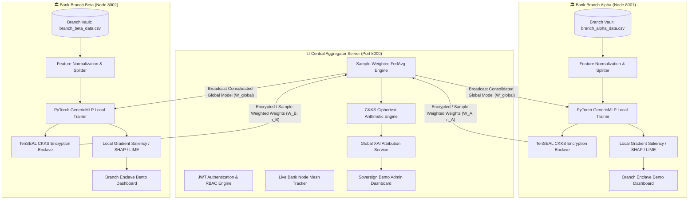

# 🏦 FedVault AI: Privacy-Preserving Federated Learning & Explainable AI for Decentralized Banking Systems

[](https://www.python.org/)
[](https://pytorch.org/)
[](https://fastapi.tiangolo.com/)
[](https://github.com/OpenMined/TenSEAL)
[](https://react.dev/)
[](https://tailwindcss.com/)
[](#-regulatory-compliance--governance)
[](LICENSE)

**FedVault AI** is a production-ready, decentralized federated learning (FL) and explainable AI (XAI) platform purpose-built for financial institutions, retail banks, and FinTech networks. It enables multiple independent bank branches to collaboratively train state-of-the-art predictive neural networks—such as **Credit Churn Prediction**, **Financial Fraud Detection**, and **Credit Risk Scoring**—without sharing, pooling, or transmitting raw customer transactions, balances, or personal identifiable information (PII).

By unifying **Sample-Weighted Federated Averaging (FedAvg)**, **Cheon-Kim-Kim-Song (CKKS) Homomorphic Encryption**, and **multi-tiered Explainable AI (Input Saliency, SHAP, and LIME)**, FedVault AI enforces institutional compliance with **GDPR (Articles 25 & 32)**, the **Gramm-Leach-Bliley Act (GLBA)**, and **Basel III/IV Model Risk Governance**, while providing full auditability through modern Sovereign Bento Grid dashboards.

---

## 📑 Table of Contents

1. [Executive Summary & Problem Statement](#-executive-summary--problem-statement)
2. [Key Innovations & Technical Pillars](#-key-innovations--technical-pillars)
3. [System Architecture](#-system-architecture)
4. [Mathematical Foundations & Algorithms](#-mathematical-foundations--algorithms)
   - [Sample-Weighted Federated Averaging (FedAvg)](#1-sample-weighted-federated-averaging-fedavg)
   - [Unbiased Global Accuracy Metric](#2-unbiased-global-accuracy-metric)
   - [First-Order Input Gradient Saliency (Micro XAI)](#3-first-order-input-gradient-saliency-micro-xai)
   - [Global First-Layer Weight Attribution (Macro XAI)](#4-global-first-layer-weight-attribution-macro-xai)
   - [CKKS Homomorphic Ciphertext Arithmetic](#5-ckks-homomorphic-ciphertext-arithmetic)
5. [Homomorphic Encryption & Threat Defense (DLG Mitigation)](#-homomorphic-encryption--threat-defense-dlg-mitigation)
6. [Tech Stack & Cryptographic Dependencies](#-tech-stack--cryptographic-dependencies)
7. [Repository File Structure](#-repository-file-structure)
8. [Installation & Deployment Guide](#-installation--deployment-guide)
   - [Prerequisites](#prerequisites)
   - [Environment Setup](#environment-setup)
   - [Dependency Installation](#dependency-installation)
   - [Compiling Frontend Bento Dashboards](#compiling-frontend-bento-dashboards)
9. [Execution Workflows](#-execution-workflows)
   - [Mode 1: Unified Full-Stack Launcher (Single Terminal)](#mode-1-unified-full-stack-launcher-single-terminal)
   - [Mode 2: Multi-Terminal Production Deployment (Separate Terminals)](#mode-2-multi-terminal-production-deployment-separate-terminals)
   - [Mode 3: Headless Multi-Node Orchestration Simulation](#mode-3-headless-multi-node-orchestration-simulation)
   - [Mode 4: Deep Leakage from Gradients (DLG) Security Verification](#mode-4-deep-leakage-from-gradients-dlg-security-verification)
10. [Comprehensive REST API Reference](#-comprehensive-rest-api-reference)
    - [Central Financial Aggregator (`http://localhost:8000`)](#central-financial-aggregator-httplocalhost8000)
    - [Bank Branch Client Node (`http://localhost:8001`)](#bank-branch-client-node-httplocalhost8001)
11. [Sovereign Bento Grid UI/UX Design System](#-sovereign-bento-grid-uiux-design-system)
12. [Regulatory Compliance & Governance](#-regulatory-compliance--governance)
13. [Authors & Technical Citation](#-authors--technical-citation)

---

## 🏛️ Executive Summary & Problem Statement

Financial institutions maintain vast repositories of sensitive transaction histories, account activity, and credit scores. However, regulatory frameworks and corporate liability prevent banks from pooling datasets into centralized data warehouses:

* **GDPR (EU 2016/679)**: Data minimization (Art. 5) and strict cross-border transfer limitations prohibit raw PII export.
* **GLBA (15 U.S.C. § 6801)**: Mandates administrative, technical, and physical safeguards for consumer financial data.
* **Basel Committee on Banking Supervision (BCBS 239 / Basel III & IV)**: Demands transparency, risk data aggregation capabilities, and explainability in algorithmic credit risk assessment.
* **Non-IID Data Islands**: Individual bank branches often possess skewed, non-identically distributed customer demographics (e.g., regional spending anomalies, specialized corporate loans). Training models strictly locally yields high variance and poor generalization.

**FedVault AI resolves this trilemma** by decoupling neural network training from centralized data collection. Model weights and loss gradients are calculated locally inside each bank's private perimeter, encrypted using lattice-based homomorphic cryptosystems, and mathematically combined into a superior global model using volume-weighted consensus.

---

## 🌟 Key Innovations & Technical Pillars

1. **🔐 Zero-Knowledge Financial Architecture**:
   Customer records never cross branch network boundaries. Only sanitized model parameter updates ($\Delta W_k$) or ciphertext tensors are transmitted to the aggregator.
2. **⚖️ Sample-Weighted FedAvg Engine**:
   Eliminates client-size bias by dynamically computing scalar contribution coefficients proportional to each branch's private sample volume ($n_k / \sum n_j$).
3. **🛡️ TenSEAL CKKS Homomorphic Encryption**:
   Parameters can be encrypted into ring-learning-with-errors (RLWE) ciphertexts. The central aggregator evaluates federated averaging additions and scalar multiplications directly over encrypted vectors without ever possessing the secret decryption key.
4. **🧠 Tri-Tier Explainable AI (XAI)**:
   * **Global Feature Attribution**: Evaluates first-layer input weight projections to determine macro banking risk drivers.
   * **Input Gradient Saliency**: Computes instantaneous first-order sensitivities ($\nabla_{\mathbf{x}} \mathcal{L}$) for millisecond fraud classification auditing.
   * **Model-Agnostic Explainers**: Integrates SHAP (Shapley Additive Explanations) and LIME (Local Interpretable Model-agnostic Explanations) for adverse credit action compliance.
5. **💎 Sovereign Bento Grid Interfaces**:
   High-density, modular dashboards built on React 18, Vite, and Tailwind CSS with a Deep Obsidian Slate, Champagne Gold, and Emerald Green visual design language.

---

## 🏗️ System Architecture



---

## 📐 Mathematical Foundations & Algorithms

### 1. Sample-Weighted Federated Averaging (FedAvg)

Let $K$ be the set of participating bank branches in federated round $t+1$. Each bank branch $k \in K$ possesses a private local dataset $\mathcal{D}_k$ containing $n_k = |\mathcal{D}_k|$ customer records, yielding a total federation volume:

$$N = \sum_{k=1}^K n_k$$

During local optimization, branch $k$ minimizes its local empirical loss:

$$w_k^{t+1} \leftarrow w^t - \eta \nabla \mathcal{L}_k(w^t; \mathcal{B}_k)$$

Upon completion of local epochs, branches transmit updated parameter tensors $W_k^{t+1}$ and volume counts $n_k$. The central aggregator computes the consensus global model:

$$W^{t+1} = \sum_{k=1}^K \left( \frac{n_k}{N} \right) W_k^{t+1}$$

This formulation guarantees that branches processing higher transaction volumes exert mathematically proportional influence over global parameter convergence.

---

### 2. Unbiased Global Accuracy Metric

To eliminate skew from micro-branches reporting high accuracy over trivial sample sizes, FedVault AI evaluates true sample-weighted federated accuracy:

$$\text{Accuracy}_{\text{global}} = \frac{\sum_{k=1}^K n_k \cdot \text{Accuracy}_k}{\sum_{k=1}^K n_k}$$

$$\text{Loss}_{\text{global}} = \frac{\sum_{k=1}^K n_k \cdot \text{Loss}_k}{\sum_{k=1}^K n_k}$$

---

### 3. First-Order Input Gradient Saliency (Micro XAI)

For high-throughput transaction evaluation, FedVault AI computes instantaneous sensitivity gradients. Given a normalized customer feature vector $\mathbf{x} = [x_1, x_2, \dots, x_d]^T \in \mathbb{R}^d$ and neural network logit output $S_c(\mathbf{x})$ for target class $c$:

$$A_i = \left| \frac{\partial S_c(\mathbf{x})}{\partial x_i} \right|$$

Attribution vector $\mathbf{A} \in \mathbb{R}^d$ is normalized across all predictive dimensions:

$$\hat{A}_i = \frac{A_i}{\sum_{j=1}^d A_j}$$

Features with the highest $\hat{A}_i$ represent the primary quantitative drivers influencing the fraud or credit denial determination.

---

### 4. Global First-Layer Weight Attribution (Macro XAI)

Macro-level feature ranking across the entire banking federation is calculated from the consolidated input layer weight tensor $W^{(1)} \in \mathbb{R}^{h \times d}$ (where $h$ is the number of hidden units in layer 1 and $d$ is feature dimensionality):

$$I_j = \frac{1}{h} \sum_{i=1}^h \left| W_{i, j}^{(1)} \right| \quad \text{for } j \in \{1, 2, \dots, d\}$$

Normalized global importance:

$$\hat{I}_j = \frac{I_j}{\sum_{k=1}^d I_k}$$

---

### 5. CKKS Homomorphic Ciphertext Arithmetic

Under the **Cheon-Kim-Kim-Song (CKKS)** cryptosystem, client parameter updates are encoded as polynomials in a cyclotomic ring $R_q = \mathbb{Z}_q[X]/(X^M + 1)$ and encrypted under public key $pk$. 

Homomorphic addition allows the aggregator to perform FedAvg arithmetic on encrypted tensors:

$$\text{Enc}_{pk}(W_A) \oplus \text{Enc}_{pk}(W_B) = \text{Enc}_{pk}(W_A + W_B)$$

Scalar multiplication with normalized sample weights $\alpha_k = n_k / N$:

$$\alpha_k \odot \text{Enc}_{pk}(W_k) = \text{Enc}_{pk}(\alpha_k \cdot W_k)$$

The aggregator computes the encrypted global tensor $\text{Enc}_{pk}(W^{t+1})$ without decrypting any intermediate values.

---

## 🛡️ Homomorphic Encryption & Threat Defense (DLG Mitigation)

In standard unencrypted federated learning, adversarial aggregators or man-in-the-middle eavesdroppers can execute **Deep Leakage from Gradients (DLG)** attacks.

### The Attack Mechanism:
An adversary intercepts local gradient tensor $\nabla W_{\text{real}}$. The adversary initializes dummy inputs $\mathbf{x}'$ and dummy labels $y'$, forward-propagates through the public architecture, and calculates dummy gradients $\nabla W(\mathbf{x}', y')$. The adversary minimizes Euclidean gradient distance:

$$\mathcal{L}_{\text{DLG}} = \left\| \nabla W(\mathbf{x}', y') - \nabla W_{\text{real}} \right\|_2^2$$

Using L-BFGS or Adam optimization on $\mathbf{x}'$, the adversary iteratively reconstructs the customer's private financial records pixel-for-pixel or feature-for-feature.

```
Without Encryption (Standard FL):
  Bank Client Gradients ──> Adversary Interception ──> DLG Optimization ──> Private Customer Records Exposed! ❌

With FedVault CKKS Encryption:
  Bank Client Gradients ──> TenSEAL CKKS Ciphertext ──> Ciphertext Addition ──> IND-CPA Security Enforced! ✅
```

### The FedVault AI Defense:
When CKKS is enabled, transmitted weight tensors are encrypted using Ring-LWE lattice cryptography. Because $\nabla W$ is ciphertext, the adversary cannot evaluate gradient distance or compute $\partial \mathcal{L}_{\text{DLG}} / \partial \mathbf{x}'$, completely defeating gradient inversion attacks with mathematical certainty.

---

## 💻 Tech Stack & Cryptographic Dependencies

* **Deep Learning Framework**: [PyTorch 2.x](https://pytorch.org/) (`torch`, `torchvision`)
* **REST & Web Infrastructure**: [FastAPI](https://fastapi.tiangolo.com/), [Uvicorn](https://www.uvicorn.org/) (ASGI, HTTP/1.1 & WebSocket ready), [Pydantic v2](https://docs.pydantic.dev/)
* **Homomorphic Cryptography**: [TenSEAL](https://github.com/OpenMined/TenSEAL) (OpenMined CKKS Homomorphic Encryption)
* **Authentication & Token Security**: [PyJWT](https://pyjwt.readthedocs.io/) (HS256 Bearer Token lifecycle), [Bcrypt](https://pypi.org/project/bcrypt/) (salted password hashing)
* **Data Engineering & Scaling**: [Pandas](https://pandas.pydata.org/), [NumPy](https://numpy.org/), [Scikit-Learn](https://scikit-learn.org/), [OpenPyXL](https://openpyxl.readthedocs.io/)
* **Explainable AI (XAI)**: [SHAP](https://shap.readthedocs.io/) (Shapley Explanations), [LIME](https://lime-ml.readthedocs.io/) (Tabular Surrogates)
* **Frontend Engineering**: [React 18](https://react.dev/), [Vite 5](https://vitejs.dev/), [Tailwind CSS 3.4](https://tailwindcss.com/), [Lucide React](https://lucide.dev/), [Chart.js 4](https://www.chartjs.org/)

---

## 📂 Repository File Structure

```
FedVault_AI/
├── client/                     # Bank Client Node backend & local execution service
│   ├── client_app.py           # FastAPI service: Dataset ingestion, local training, XAI & HE
│   ├── app.js                  # Vanilla JS fallback client application
│   ├── index.html              # Static client entrypoint fallback
│   └── style.css               # Sovereign dark theme styling for client fallback
├── client-dashboard/           # Bank Branch Node Modern React 18 / Vite Frontend
│   ├── src/
│   │   ├── App.jsx             # 5-Step Bento Step Wizard & Enclave Terminal
│   │   ├── index.css           # Sovereign design system tokens (.bento-card, glows)
│   │   └── main.jsx            # React root DOM mounting
│   ├── package.json            # Frontend dependency manifest
│   ├── tailwind.config.js      # Sovereign palette extension (Obsidian, Gold, Emerald)
│   └── vite.config.js          # Vite build & asset configuration
├── server/                     # Central Financial Aggregator Hub backend
│   ├── server.py               # Aggregator FastAPI server: FedAvg engine, auth, mesh tracking
│   ├── xai_utils.py            # Gradient Saliency, SHAP & LIME computation engine
│   ├── fedvault_db.json        # Persistent JSON state (Users, Sessions, Rounds)
│   ├── app.js                  # Vanilla JS fallback server dashboard
│   ├── index.html              # Static server entrypoint fallback
│   └── style.css               # Sovereign dark theme styling for server fallback
├── server-dashboard/           # Central Aggregator Modern React 18 / Vite Frontend
│   ├── src/
│   │   ├── App.jsx             # Aggregator Bento Command Center (Metrics, Mesh, XAI, Logs)
│   │   ├── index.css           # Sovereign design system tokens (.bento-card-gold, etc.)
│   │   └── main.jsx            # React root DOM mounting
│   ├── package.json            # Frontend dependency manifest
│   ├── tailwind.config.js      # Sovereign palette extension (Obsidian, Gold, Emerald)
│   └── vite.config.js          # Vite build & asset configuration
├── core/                       # Shared modules across server and bank nodes
│   ├── models.py               # GenericMLP & BankingFraudNN PyTorch architectures
│   ├── dataset.py              # TabularDataset processor & DataLoader utilities
│   └── he_utils.py             # TenSEAL CKKS encryption context & serialization
├── data/                       # Financial training datasets & partitioned branch records
│   ├── sample_banking.csv      # Unified 10,000-record benchmark banking dataset
│   ├── branch_alpha_data.csv   # Isolated partition for Bank Branch Alpha (Node 8001)
│   └── branch_beta_data.csv    # Isolated partition for Bank Branch Beta (Node 8002)
├── scripts/                    # Automation, orchestration & security validation tools
│   ├── run_all.py              # Unified single-command launcher (Server + Client)
│   ├── attack_simulation.py    # Deep Leakage from Gradients (DLG) vs CKKS simulation
│   ├── client.py               # Headless automated bank client simulation script
│   └── main.py                 # Multi-round multi-node orchestration orchestrator
├── requirements.txt            # Python dependencies specification
├── reorganization_report.md    # Historical migration and refactoring log
└── README.md                   # Technical system documentation
```

---

## 🚀 Installation & Deployment Guide

### Prerequisites

* **Python**: `3.10` or higher (`python --version`)
* **Node.js**: `18.x` or higher & `npm` (`node -v`, `npm -v`)
* **Operating System**: Windows (PowerShell), Linux (Ubuntu 20.04+), or macOS

### Environment Setup

1. **Clone the repository**:
   ```bash
   git clone https://github.com/prathmesh-nitnaware/FedVault_AI.git
   cd FedVault_AI
   ```

2. **Initialize Python Virtual Environment**:
   * **Windows (PowerShell)**:
     ```powershell
     python -m venv .venv
     .\.venv\Scripts\Activate.ps1
     ```
   * **Linux / macOS**:
     ```bash
     python3 -m venv .venv
     source .venv/bin/activate
     ```

### Dependency Installation

Install all required machine learning, cryptography, web, and explainability libraries:

```bash
pip install -r requirements.txt
```

### Compiling Frontend Bento Dashboards

Build the production Vite bundles for both the Aggregator Server and Bank Client Node:

```bash
# Compile Central Aggregator Dashboard
cd server-dashboard
npm install && npm run build
cd ..

# Compile Bank Client Node Dashboard
cd client-dashboard
npm install && npm run build
cd ..
```

---

## ⚙️ Execution Workflows

### Mode 1: Unified Full-Stack Launcher (Single Terminal)

Launch both the **Central Aggregator Hub** (`:8000`) and the default **Bank Branch Client Node** (`:8001`) with a single command:

```powershell
python scripts/run_all.py
```

* **Central Aggregator Dashboard**: [http://localhost:8000](http://localhost:8000)
* **Bank Branch Client Portal**: [http://localhost:8001](http://localhost:8001)

---

### Mode 2: Multi-Terminal Production Deployment (Separate Terminals)

For authentic multi-node simulation across separate terminals or separate networked workstations:

#### **Terminal 1: Central Financial Aggregator Hub**
```powershell
.\.venv\Scripts\Activate.ps1
cd server
python -m uvicorn server:app --host 0.0.0.0 --port 8000 --reload
```
* Access Aggregator Command Center at: **[http://localhost:8000](http://localhost:8000)**

#### **Terminal 2: Bank Branch Node Alpha (Port 8001)**
```powershell
.\.venv\Scripts\Activate.ps1
cd client
python client_app.py --port 8001
```
* Access Branch Alpha Portal at: **[http://localhost:8001](http://localhost:8001)**
* Action: Authenticate, upload `data/branch_alpha_data.csv`, run local PyTorch epochs, and transmit weights.

#### **Terminal 3: Bank Branch Node Beta (Port 8002)**
```powershell
.\.venv\Scripts\Activate.ps1
cd client
python client_app.py --port 8002
```
* Access Branch Beta Portal at: **[http://localhost:8002](http://localhost:8002)**
* Action: Authenticate as Branch Beta, upload `data/branch_beta_data.csv`, execute local training, and transmit weights.
* **Observe Aggregator**: As soon as both branches transmit, the aggregator automatically reaches its quorum threshold (2 nodes) and executes Sample-Weighted FedAvg consolidation!

---

### Mode 3: Headless Multi-Node Orchestration Simulation

To execute an end-to-end automated 3-round federated training run without manual browser interaction:

```powershell
python scripts/main.py
```

Or run an individual headless client script:

```powershell
python scripts/client.py --id 0 --url http://localhost:8000 --scale 1.0
```

* `--id` (Required, int): Unique bank node identifier.
* `--url` (Optional, str): Central aggregator URL (defaults to `http://localhost:8000`).
* `--scale` (Optional, float): Model width scaling factor for compute heterogeneity (defaults to `1.0`).

---

### Mode 4: Deep Leakage from Gradients (DLG) Security Verification

Validate how gradient inversion attacks execute against unencrypted gradients versus how they fail against CKKS homomorphic encryption:

```powershell
python scripts/attack_simulation.py
```

* **Step 1**: Simulates an adversary intercepting raw PyTorch gradients and running gradient matching optimization ($\min \|\nabla W' - \nabla W\|^2$) to reconstruct customer records.
* **Step 2**: Evaluates the identical attack over TenSEAL CKKS ciphertext vectors, demonstrating complete mathematical inversion failure.

---

## 🔌 Comprehensive REST API Reference

### Central Financial Aggregator (`http://localhost:8000`)

| Method | Endpoint | Auth | Description |
| :--- | :--- | :--- | :--- |
| `POST` | `/auth/register` | Public | Enrolls a new bank node administrator / operator. Returns JWT bearer token. |
| `POST` | `/auth/login` | Public | Authenticates operator credentials. Returns JWT bearer token. |
| `GET` | `/auth/me` | Bearer | Validates active session token and returns authenticated operator metadata. |
| `GET` | `/status` | Public | Returns complete telemetry: active round, online nodes, convergence metrics, and quorum status. |
| `POST` | `/heartbeat` | Optional Bearer | Registers node presence and updates online timestamps (supports unauthenticated nodes). |
| `POST` | `/submit-update` | Bearer | Ingests local model weight tensors, sample count ($n_k$), loss, and accuracy from a bank branch. |
| `GET` | `/global-model` | Optional Bearer | Exports the current aggregated global model weights and layer configuration. |
| `GET` | `/xai/importance` | Public | Computes global first-layer feature importance attribution across the federation. |
| `POST` | `/predict` | Public | Executes real-time inference on customer parameters with Saliency, SHAP, and LIME explanations. |
| `POST` | `/admin/set-min-clients` | Public | Dynamically reconfigures the required quorum threshold ($K_{\min}$) for auto-aggregation. |
| `POST` | `/admin/aggregate-now` | Public | Forces immediate Sample-Weighted FedAvg consolidation on currently buffered client updates. |
| `GET` | `/admin/nodes` | Public | Returns live and historical connection records for all participating bank institutions. |
| `GET` | `/admin/sessions` | Public | Returns recent training round history and participant logs. |

---

### Bank Branch Client Node (`http://localhost:8001`)

| Method | Endpoint | Description |
| :--- | :--- | :--- |
| `GET` | `/status` | Returns node operational state: dataset loaded, training status, and local metrics. |
| `GET` | `/logs` | Returns live local execution and diagnostic event trace. |
| `POST` | `/upload-dataset` | Ingests a local banking CSV/Excel file into the branch's private vault enclave. |
| `POST` | `/dataset/load-sample` | Automatically loads the branch partition sample dataset. |
| `POST` | `/train/local` | Triggers local PyTorch training epochs on private records; computes $\Delta W_k$. |
| `POST` | `/train/send-weights` | Encrypts local weights (CKKS) and transmits update payload to the central aggregator. |
| `POST` | `/validate/global` | Pulls global model from aggregator and evaluates performance against local branch test data. |
| `POST` | `/predict` | Evaluates local customer fraud risk with instantaneous gradient saliency explanation. |

---

## 🎨 Sovereign Bento Grid UI/UX Design System

FedVault AI features a custom-engineered **Sovereign Fintech Bento Grid** interface designed specifically for executive banking oversight:

```
┌─────────────────────────────────────────────────────────────────────────────┐
│ 🛡️ FedVault AI  [Sovereign Core]  [Basel III/IV Compliant]   [CKKS HE Active]│
├─────────────────┬─────────────────┬───────────────────┬─────────────────────┤
│ GLOBAL ACCURACY │ ACTIVE MESH     │ CONSENSUS ROUNDS  │ PRIVACY PROTOCOL    │
│     94.2%       │ 2 Institutions  │     Round #3      │ TenSEAL CKKS        │
│ Sample-Weighted │ 10,000 Records  │ Target: 95.0%     │ Zero Raw Data Leak  │
├─────────────────┴─────────────────┴───────────────────┴─────────────────────┤
│ ⚡ ROUND #4 AGGREGATION QUORUM: [1 Node] [2 Nodes] [3 Nodes]  [RUN FEDAVG NOW]│
│ Buffer: 2 of 2 bank nodes submitted (Branch Alpha, Branch Beta)             │
├───────────────────────────────────────────┬─────────────────────────────────┤
│ 📈 GLOBAL FEDERATED CONVERGENCE TRAJECTORY │ 🏛️ ACTIVE INSTITUTION MESH      │
│ (Champagne Gold Stroke • Emerald Hover)   │ • Branch Alpha (93.4% Acc)      │
│ Round 1 ──> Round 2 ──> Round 3           │ • Branch Beta  (91.8% Acc)      │
├───────────────────────────────────────────┴─────────────────────────────────┤
│ 🔬 GLOBAL XAI FEATURE ATTRIBUTION & FRAUD RISK SIMULATOR                     │
│ [TransactionAmount: 28%] [CreditScore: 22%] [Balance: 18%] [Age: 14%]       │
└─────────────────────────────────────────────────────────────────────────────┘
```

* **Color Tokens**:
  * **Deep Obsidian**: `#05070D` (background), `#0A0E1A` (card background), `#1E263D` (borders).
  * **Champagne Gold**: `#D4AF37` (brand crest), `#F5D76E` (gradient highlights), `#E5BE3A` (convergence line).
  * **Sovereign Emerald**: `#10B981` (active telemetry), `#34D399` (accuracy badges), `#059669` (verified privacy).
* **Typography**: Plus Jakarta Sans for executive hierarchy; JetBrains Mono for cryptographic hashes, metrics, and network addresses.
* **Component Primitives**: `.bento-card`, `.bento-card-gold`, `.bento-card-emerald`, `.glass-card-hover`.

---

## ⚖️ Regulatory Compliance & Governance

| Regulation / Standard | Requirement | How FedVault AI Enforces It |
| :--- | :--- | :--- |
| **GDPR Art. 5(1)(c)** | Data Minimization | Raw personal data never leaves the originating bank branch perimeter. |
| **GDPR Art. 25 & 32** | Privacy by Design & Default | Weights are encrypted via TenSEAL CKKS homomorphic cryptography before egress. |
| **GLBA (15 U.S.C. § 6801)** | Protection of Consumer Information | Intermediate training states cannot be reversed to reconstruct customer records. |
| **Basel III / IV** | Model Risk Management & Validation | Multi-tier XAI (Saliency, SHAP, LIME) provides full auditability of decision logic. |
| **Fair Credit Reporting Act (FCRA)** | Adverse Action Notices | Branch operators can generate mathematical feature attribution justifying credit decisions. |

---

## 👥 Authors & Technical Citation

* **Prathmesh Nitnaware** — [@prathmesh-nitnaware](https://github.com/prathmesh-nitnaware)
* **Yash Kasle** — [@BuildnByte](https://github.com/BuildnByte)

### Research Domains
Privacy-Preserving Machine Learning (PPML) • Decentralized Banking Systems Governance • Sample-Weighted Federated Learning • Homomorphic Encryption (CKKS) • Multi-Layer Explainable Artificial Intelligence (XAI).
