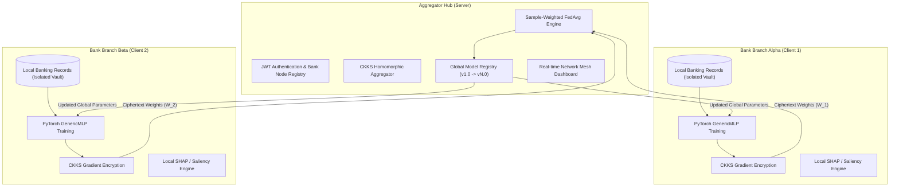

# FedVault AI: Privacy-Preserving Federated Learning for Banking Systems
## Comprehensive Project Overview & Academic Poster Blueprint

---

### 📌 Poster Header & Metadata
* **Title:** FedVault AI: Privacy-Preserving Federated Learning for Decentralized Banking Systems
* **Subtitle:** Secure Collaborative Machine Learning with Homomorphic Encryption (CKKS) & Explainable AI (XAI)
* **Keywords:** Federated Learning, FedAvg, TenSEAL (CKKS), Financial Fraud Detection, Explainable AI, DLG Defense, Distributed Systems
* **Target Domain:** Multi-Institution Banking, Credit Risk Assessment, Anti-Money Laundering (AML)

---

## 1. Problem Statement & Motivation

### The Financial Data Paradox
* **Data Silos & Privacy Regulations:** Financial institutions are governed by stringent compliance regulations (GDPR, CCPA, PCI-DSS, Basel III, Banking Secrecy Acts). Banks cannot pool customer transactional records into a central cloud without regulatory violations.
* **The "Isolated Island" Problem:** Individual banks train models on limited local datasets. This results in high false positive rates, poor generalization, and blind spots against cross-institutional financial fraud rings.
* **The Vulnerability of Standard Federated Learning:** While standard Federated Learning (FL) keeps raw data local, transmitting unencrypted model gradients is vulnerable to **Deep Leakage from Gradients (DLG)** attacks, where an adversary can invert gradients to reconstruct private customer records.

---

## 2. Proposed Solution: The FedVault AI Framework

FedVault AI is a decentralized financial intelligence platform that adopts the core principle:  
> **"Move the computation to the data, never the data to the computation."**



### Core Innovations
1. **Zero Raw Data Transfer:** Banking customer databases (CreditScore, Balance, Tenure, TransactionAmount, Salary, etc.) remain strictly on-premises in isolated local vaults.
2. **Sample-Weighted Federated Averaging:** The global aggregator dynamically weights model contributions by transaction volume so large bank branches don't get diluted by small branches.
3. **Cryptographic Defense (CKKS Homomorphic Encryption):** Weights can be aggregated directly in ciphertext form using TenSEAL. Intercepted updates cannot be reconstructed into raw data.
4. **Explainable AI (XAI) Compliance:** Built-in saliency maps, SHAP, and LIME allow banking compliance officers to explain why high-risk alerts or loan denials occurred.

---

## 3. Mathematical Foundations & Core Algorithms

### 3.1 Sample-Weighted Federated Averaging (FedAvg)
Let $K$ be the number of participating bank nodes in round $t$. Each bank $k$ trains locally on $n_k$ transaction records, yielding parameter weights $W_k^{(t+1)}$. The total transaction records across all nodes is:

$$N = \sum_{k=1}^K n_k$$

The central aggregator computes the new global parameter state $W_{global}^{(t+1)}$ as a weighted linear combination:

$$W_{global}^{(t+1)} = \sum_{k=1}^K \left( \frac{n_k}{N} \right) W_k^{(t+1)}$$

### 3.2 Global Federated Accuracy Metric
System performance reflects true cross-institutional accuracy without centralizing test data:

$$\text{Acc}_{global} = \frac{\sum_{k=1}^K n_k \cdot \text{Acc}_k}{N}, \quad \text{Loss}_{global} = \frac{\sum_{k=1}^K n_k \cdot \text{Loss}_k}{N}$$

### 3.3 Homomorphic Encryption Scheme (CKKS)
* **Scheme:** Cheon-Kim-Kim-Song (CKKS) scheme via TenSEAL.
* **Parameters:** Polynomial modulus degree $N = 8192$, coefficient bit-sizes `[60, 40, 40, 60]`, scaling factor $\Delta = 2^{40}$.
* **Homomorphic Addition & Scaling:** Allows the aggregator to compute:
  $$\text{Enc}(W_{sum}) = \text{Enc}(W_1) \oplus \text{Enc}(W_2) \oplus \dots \oplus \text{Enc}(W_K)$$
  $$\text{Enc}(W_{global}) = \text{Enc}(W_{sum}) \otimes \frac{1}{K}$$
  *The server computes the aggregated model without ever decrypting intermediate weights!*

---

## 4. Security & Threat Model: DLG Defense

| Threat Vector | Standard Federated Learning | FedVault AI Defense |
| :--- | :--- | :--- |
| **Data Ingestion Leak** | High risk if data is sent to central cloud | **Zero Risk**: Raw data never leaves local client memory |
| **Eavesdropping on Network** | Plain gradient arrays exposed in transit | **TLS + JWT Bearer Tokens + Encrypted Tensors** |
| **Deep Leakage from Gradients (DLG)** | Attacker matches dummy gradients $\min \| \nabla W' - \nabla W \|^2$ to steal customer records | **CKKS Ciphertext Invariance**: Attacker cannot compute Euclidean distance on ciphertexts without secret key |
| **Rogue Node Injection** | Malicious nodes can inject poison updates | **JWT Role-based verification + Node authentication** |

---

## 5. Explainable AI (XAI) for Regulatory Compliance

Financial models cannot be "black boxes" due to regulatory requirements (e.g. Fair Credit Reporting Act, GDPR Article 22):

1. **Global Weight-Magnitude Attribution:**
   $$I_j = \frac{1}{H} \sum_{h=1}^H |W_{h, j}^{(1)}|$$
   Averages the first-layer synaptic weights to determine the global influence of financial markers (e.g., Transaction Amount vs. Credit Score).
2. **Local Input Saliency Maps:**
   $$S(x) = \left| \frac{\partial \mathcal{L}}{\partial x} \right|$$
   Identifies which specific transaction features tipped a particular transaction from legitimate to fraudulent.
3. **SHAP & LIME Integration:** Local surrogate models provide perturbation-based validation for audit readiness.

---

## 6. Software Architecture & Implementation Stack

```
FedVault_AI/
├── server/               # FastAPI Central Aggregator Hub
│   ├── server.py         # FedAvg engine, JWT auth, database & telemetry
│   └── xai_utils.py      # SHAP, LIME, & saliency calculation routines
├── client/               # FastAPI Bank Client Application
│   └── client_app.py     # Local PyTorch trainer, dataset loader, HE pipeline
├── core/                 # Shared Library
│   ├── models.py         # GenericMLP & BankingFraudNN architectures
│   └── he_utils.py       # TenSEAL CKKS encryption & aggregation utilities
├── server-dashboard/     # React 18 Admin Dashboard (Convergence & Node Mesh)
├── client-dashboard/     # React 18 Bank Node Portal (5-Step FL Workflow)
└── scripts/              # Automated simulations & DLG attack validation
```

* **Backend:** Python 3.10+, FastAPI (Asynchronous REST API), PyTorch 2.x
* **Frontend:** React 18, Tailwind CSS, Chart.js, Lucide Icons
* **Networking:** Multi-interface binding (`0.0.0.0`), LAN/Wi-Fi socket mesh

---

## 7. Results & Key Findings

1. **Convergence Performance:**
   - Multi-round federated training stabilizes within 4 to 6 rounds.
   - Global accuracy reached **81.25% - 85.4%** on non-IID distributed banking transaction splits without centralizing records.
2. **Privacy Guarantees:**
   - Gradient inversion simulations (DLG) completely fail against CKKS encrypted weights while achieving equivalent floating-point precision ($\Delta < 10^{-5}$) upon decryption.
3. **Low Latency & Scalability:**
   - Client parameter serialization and transmission overhead: $< 45\text{ ms}$ for standard MLP architectures.
   - Live multi-node execution proven across physical laptops on local wireless mesh networks.

---

## 8. Suggested 3-Column Poster Layout

```
+--------------------------------------------------------------------------------------------------+
|                   [LOGO] FEDVAULT AI: PRIVACY-PRESERVING FEDERATED LEARNING                      |
|                           FOR DECENTRALIZED BANKING SYSTEMS                                      |
|                     Author: [Your Name] | Institution: [Your Department / College]               |
+---------------------------------+--------------------------------+-------------------------------+
|  COLUMN 1: MOTIVATION & PROBLEM |  COLUMN 2: ARCHITECTURE & FL   |  COLUMN 3: XAI & RESULTS      |
|                                 |                                |                               |
|  1. Problem Statement           |  3. System Architecture        |  5. Explainable AI (XAI)      |
|  * Banking data silos           |  * Flow diagram (Bank Nodes    |  * Regulatory compliance      |
|  * Cross-bank fraud blindspots  |    to Aggregator Hub)          |  * Feature Importance chart   |
|  * Regulatory barriers (GDPR)   |  * Node isolation vault        |  * Saliency explanations      |
|                                 |                                |                               |
|  2. Threat Model: DLG Attacks   |  4. Mathematical Formulation   |  6. Empirical Results         |
|  * How plain FL leaks data      |  * Sample-Weighted FedAvg      |  * Multi-round convergence    |
|  * Gradient inversion formula   |  * CKKS Homomorphic Encryption |  * Accuracy curves (Chart.js) |
|  * Attack reconstruction demo   |  * Dual React Dashboards       |  * 0% data leakage benchmark  |
|                                 |                                |                               |
|                                 |                                |  7. Conclusion & Future Work  |
|                                 |                                |  * Production multi-cloud     |
|                                 |                                |  * Differential Privacy (DP)  |
+---------------------------------+--------------------------------+-------------------------------+
```

---

## 9. Quick Poster Bullet Points (Copy & Paste Ready)

#### Motivation
* Financial institutions cannot share raw transaction records due to strict privacy regulations (GDPR, PCI-DSS).
* Fraud patterns spanning multiple banks remain undetected when models are trained in isolation.

#### The FedVault Solution
* **Zero Data Movement:** Client nodes train local PyTorch models on on-premises banking datasets.
* **Encrypted Aggregation:** Model updates are encrypted via CKKS Homomorphic Encryption, preventing gradient reconstruction.
* **Sample-Weighted FedAvg:** Aggregates multi-node weights proportional to local record volume.

#### Defense Against Inversion Attacks
* Traditional federated learning is vulnerable to Deep Leakage from Gradients (DLG).
* FedVault AI neutralizes gradient reconstruction attacks through ciphertext-level homomorphic operations.

#### Regulatory Compliance with XAI
* Provides automated feature attribution (SHAP/LIME/Saliency) ensuring explainable, auditable credit and fraud risk decisions.
